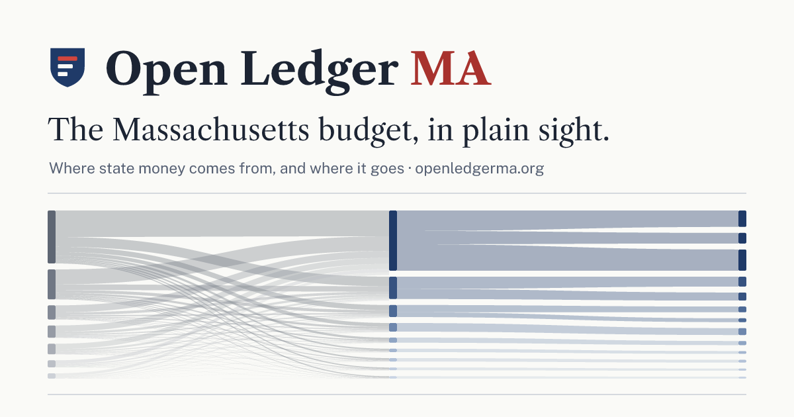

# Open Ledger MA

**The Massachusetts budget, in plain sight.**

[openledgerma.org](https://openledgerma.org) follows a state tax dollar from where it is
collected to what it pays for. Three views, one click each:

- **Flow** — where the money comes from and where it goes (revenue → spending area → program).
- **Scale** — how big things are next to each other (zoomable treemap of the whole budget).
- **Changes** — what moved between two fiscal years, in dollars and percent.

Fiscal years 2024–2027 are covered. FY2027 is in progress and labeled as such.



## Where the numbers come from

Every figure on the site traces to a row in a public dataset published by the
Massachusetts Office of the Comptroller (CTHRU):

| Dataset | ID | Used for |
|---|---|---|
| Budget-to-Actual with Other Spending Authorization | `kv7m-35wn` | Enacted appropriations and actual spending, by appropriation account |
| Commonwealth Revenue Collections | `kcy7-ivxi` | Revenue by source, budgeted funds only |

Dataset IDs, pull dates, field definitions, how categories were built, and the known
limitations are all in [METHODOLOGY.md](METHODOLOGY.md). The category tree is checked
against the MassBudget Budget Browser, which is not scraped.

The site is nonpartisan. It describes amounts; it does not grade them.

## Run it locally

```bash
pnpm install
pnpm dev
```

Rebuild the data from source (Python 3.12+):

```bash
make setup   # venv + deps
make pull    # fetch raw CSVs into etl/raw/ (gitignored)
make build   # write data/**/*.json
make check   # assert totals reconcile within 0.5%
```

## Layout

```
etl/          Python ETL: pull.py, build.py, check.py, mapping.csv, names.py
data/         Generated JSON, committed (one folder per fiscal year + diffs)
src/          React + TypeScript app (Vite, Tailwind, D3)
public/       Static assets
METHODOLOGY.md
```

## Deploy

Static build in `dist/`, served by Cloudflare at openledgerma.org.
Run `pnpm deploy` after `wrangler login`.

The data refreshes itself: `.github/workflows/refresh-data.yml` runs every Monday (or on demand from
the Actions tab), pulls CTHRU again, rebuilds and checks the data, commits it and deploys. It needs
the `CLOUDFLARE_API_TOKEN` and `CLOUDFLARE_ACCOUNT_ID` repository secrets. Run `git pull` before
working locally so you have the latest data.

## Privacy

No cookies and no ads. Visits are counted with Cloudflare Web Analytics, which sets no cookies
and collects no personal data. The Source rows page reads records straight from the state's CTHRU
API. Fonts are self-hosted.

## License

MIT. See [LICENSE](LICENSE).
